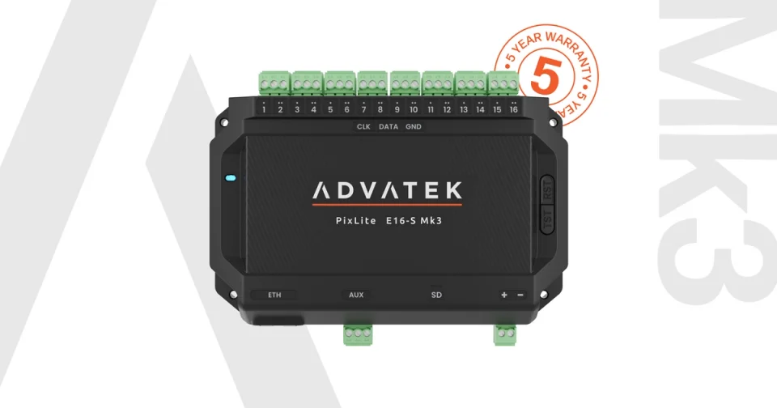

# Advatek PixLite Mk3

Operate commissioned SHOWTime content from Companion. Select scenes and playlists, manage playback, adjust brightness and recall colours from the same surface as the rest of your show.

## What you can control

- Play existing scenes and playlists, pause or resume, restart an item and move through a playlist.
- Switch to live data, freeze the current frame or blank outputs.
- Adjust pixel intensity and configured auxiliary DMX output intensity.
- Recall RGB, RGBW or RGBCCT colours, use commissioned palette entries, or prepare a colour mix before recalling it. An explicit Live Mix toggle enables immediate adjustments in Static Colour mode.
- Follow playback, connection state and available device statistics through button feedback and variables. A4-S models also expose supported temperature, power and fuse readings.

Dark and light presets include the actions, labels and feedback needed to get started. Scene and playlist choices come from the controller; filenames and other commands can also be prepared offline.

## Get started

Requires controller firmware **v3.15.0 or later**, API v1.9 and an enabled operator account.

1. Install **Advatek PixLite Mk3** from **Modules**, then add a connection in **Connections**.
2. Choose **Find controllers**, select your network interface, scan and choose **Use controller**. Reopen the connection settings and enter the operator password. You can also enter the controller address manually; HTTPS requires its device MAC.
3. Save, then open **Buttons > Presets** and select the connection. Drag dark or light SHOWTime keys onto your layout.
4. Copy or convert a scene or playlist template to an editable button, then select its content in the action. For manual filenames, include `.scn` or `.pl` and choose **Use** in the dropdown to save the selection.

For a local setup, keep Companion and the controller on the same IPv4 subnet. ADAR discovery uses UDP **49151**. Connection ports are selected automatically: HTTP **80**, HTTPS **4443**.

## Useful to know

Use one connection per controller. Controllers play independently. Status refresh is automatic; connecting does not start playback or recall an intensity.

Colour and white-channel controls follow the controller's commissioned pixel type. Static colour replaces playback; it does not recolour a recorded scene. **Release override** returns intensity authority to the commissioned source; it does not recall full brightness.

Commissioning, recording, trigger creation, file management and controller settings remain in Advatek software.

[Operator guide](https://github.com/bitfocus/companion-module-advatek-pixlite-mk3/blob/main/docs/OPERATOR-GUIDE.md) | [Example workspace](https://github.com/bitfocus/companion-module-advatek-pixlite-mk3/blob/main/companion/EXAMPLE.md) | [HTTPS help](https://github.com/bitfocus/companion-module-advatek-pixlite-mk3/blob/main/docs/HTTPS.md) | [Report an issue](https://github.com/bitfocus/companion-module-advatek-pixlite-mk3/issues)
